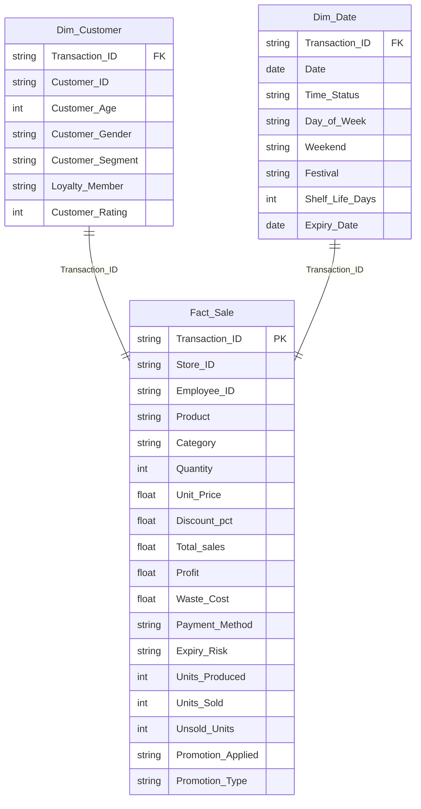

# 🥐 Bakery Sales, Profitability & Waste Optimization Dashboard

An end-to-end Excel analytics project that analyses **16,569 bakery transactions (Jan 2023 – Dec 2024)** across 3 stores to uncover where the business makes and loses money, and how much waste, discounting and production planning cost it.


---

## 📌 Table of Contents
1. [Business Problem](#-business-problem)
2. [Project Objectives](#-project-objectives)
3. [Dataset](#-dataset)
4. [Data Model](#-data-model)
5. [Dashboards](#-dashboards)
6. [KPIs](#-kpis)
7. [Key Insights](#-key-insights)
8. [Recommendations](#-recommendations)
9. [Tools & Techniques](#-tools--techniques)
10. [Repository Structure](#-repository-structure)
11. [How to Use](#-how-to-use)
12. [Author](#-author)

---

## 🎯 Business Problem
The bakery generates healthy revenue but **ends with a net loss**. Management needs to know:
- Which products, categories and stores make or lose money?
- How much are discounts and promotions hurting margin?
- How much food is being wasted, and why?
- When (day, time, season) and who (customer segment) drives sales?

## ✅ Project Objectives
- Build an interactive **Sales Dashboard** and **Transaction Dashboard** in Excel.
- Model the data as a **star schema** using the Excel Data Model (Power Pivot).
- Track profit, waste, discount and production KPIs.
- Deliver actionable, quantified business recommendations.

---

## 📂 Dataset

| Item | Detail |
|---|---|
| **Raw Source file** | [`Backery_raw_dataset.xlsx`](https://github.com/TCWaghmare/Bakery_Data_Analysis_Project_by_Excel/blob/main/Dataset/bakery_raw_dataset.csv.xlsx)|
| **Filterd Source file** | [`Backery_filterd_dataset.xlsm`](https://github.com/TCWaghmare/Bakery_Data_Analysis_Project_by_Excel/blob/main/Excel_Dashboard/Backery_data_analysis_dashboard.xlsm) (data + pivots + dashboards) |
| **Period** | 01 Jan 2023 – 31 Dec 2024 (731 days) |
| **Grain** | One row per transaction (`Transaction_ID`) |
| **Rows** | 16,569 |
| **Stores** | 3 (ST01, ST02, ST03) |
| **Products / Categories** | 35 products / 10 categories |
| **Customers** | 2,173 unique customers |
| **Employees** | 60 (20 per store) |

> The data is a bakery transaction dataset; it appears to be synthetic/simulated. Add your original source link here if you have one: `[Dataset source](#)`.

### Tables

| Sheet | Type | Rows × Cols | Description |
|---|---|---|---|
| `Fact_Sale` | Fact | 16,569 × 31 | Sales, pricing, discount, profit, waste, stock/production and promotion details |
| `Dim_Customer` | Dimension | 16,569 × 8 | Customer ID, age, gender, segment, loyalty, rating |
| `Dim_Date` | Dimension | 16,569 × 10 | Date, time slot, weekday/weekend, festival, shelf life, manufacturing/expiry dates |
| `Sales` | Dashboard | – | Sales dashboard (charts + slicers) |
| `Transaction` | Dashboard | – | Transaction / waste dashboard |
| `Analytics` | Analysis | – | 20 pivot tables, 36 charts and KPI measures |
| `Insights` | Report | – | Business insights summary |

### Data Dictionary

<details>
<summary><b>Fact_Sale</b> (click to expand)</summary>

| Column | Description |
|---|---|
| `Transaction_ID` | Unique transaction key (primary key) |
| `Employee_ID`, `Store_ID` | Employee and store that made the sale |
| `Product`, `Category` | Product sold and its category |
| `Quantity` | Units bought in the transaction |
| `Unit_Price` | List price per unit |
| `Discount_%`, `Discount_Category`, `Discount_Amount` | Discount rate, slab (No / Low / Medium / High) and value |
| `Selling_Price` | Price per unit after discount |
| `Total_sales` | Revenue = `Selling_Price × Quantity` |
| `Profit` | Profit of the transaction (appears to be net of waste cost) |
| `Waste_Cost` | Cost of unsold / wasted stock |
| `Payment_Method` | UPI, Card, Cash, Wallet |
| `Weather`, `Temperature`, `Season` | Weather context |
| `Expiry_Risk` | Low / Medium / High |
| `Stock_Available`, `Units_Produced`, `Units_Sold`, `Unsold_Units` | Production and stock figures |
| `Sold_Rate`, `Sold_Rate_Status` | Sell-through rate and band (Low, Half, Near Half, Partial, Near All) |
| `Promotion_Applied`, `Promotion_Type`, `Promotion_Score` | Promotion flag, type and score |
| `Recommended_Product`, `Recommended_Discount` | Recommendation fields |
| `Dim_Customer.Customer_Rating` | Customer rating (1–5) |

</details>

<details>
<summary><b>Dim_Customer</b></summary>

| Column | Description |
|---|---|
| `Transaction_ID` | Key to `Fact_Sale` |
| `Customer_ID` | Customer identifier |
| `Customer_Age`, `Customer_Age_Category` | Age and group (Teen / Adult / Senior) |
| `Customer_Gender` | Female / Male / Other |
| `Customer_Rating` | Rating 1–5 |
| `Customer_Segment` | Student, Young Professional, Family, Senior Citizen |
| `Loyalty_Member` | Yes / No |

</details>

<details>
<summary><b>Dim_Date</b></summary>

| Column | Description |
|---|---|
| `Transaction_ID` | Key to `Fact_Sale` |
| `Date`, `Time`, `Time Status` | Date, time and slot (Morning / Afternoon / Evening) |
| `Day_of_Week`, `Weekend` | Weekday name and weekend flag |
| `Festival` | Festival name (blank on normal days) |
| `Shelf_Life_Days`, `Manufacturing_Date`, `Expiry_Date` | Shelf-life details |

</details>

---

## 🧩 Data Model

A **star schema** built in the Excel Data Model (Power Pivot), with `Fact_Sale` joined to two dimensions on `Transaction_ID` (one-to-one).



📸 *Add a screenshot of your Power Pivot diagram view too:* `images/data_model.png`


---

## 📊 Dashboards

> 📸 Take screenshots of each dashboard sheet and save them in the `images/` folder using the names below.

### 1. Sales Dashboard


**Visuals:** Top 10 products by revenue, profit-making products, revenue by store, promotion type, festival, gender, discount slab, season, profit vs revenue trend, and daily revenue.
**Slicers:** Year, Category, Weekend, Loyalty Member, Customer Gender, Promotion Applied.

### 2. Transaction Dashboard


**Visuals:** Waste cost by product, produced vs sold units, produced vs unsold by expiry risk, sold/unsold rate by category, payment method, ratings, transactions by time of day, and customer segment.
**Slicers:** Year, Category, Sold Rate Status, Weekend.

### 3. Analytics Sheet (pivot tables & KPI measures)


---

## 📈 KPIs

| KPI | Value |
|---|---|
| Total Transactions | **16,569** |
| Total Revenue | **3,444,113** |
| Total Profit | **−230,339** |
| Profit Margin | **−6.7%** |
| Total Waste Cost | **1,388,813** (40.3% of revenue) |
| Loss-making Transactions | **50.4%** |
| Avg Revenue per Transaction | **207.86** |
| Avg Customer Rating | **3.68 / 5** |

---

## 💡 Key Insights

### Sales Dashboard
1. **Two cakes carry the business.** Chocolate and Black Forest Cake are 31% of revenue, yet both lose money (−7.5% and −10.4% margin).
2. **Only 12 of 35 products are profitable** (+97K total); the other 23 lose 327K.
3. **Beverages are the profit engine:** +75K at a 21% margin (Tea, Coffee, Cold Coffee).
4. **Dairy and Spreads lose 180K** on 24% of revenue.
5. **Discounts are the biggest leak.** Medium and High slabs lose 251K, more than the whole company loss. The High slab runs at −54% margin and does not improve ratings.
6. **Weekends = 45% of revenue** but lose 857/day (weekdays lose 98/day) because of 10% average weekend discounts.
7. **Growth is flat:** revenue was 1.724M in 2023 and 1.720M in 2024, with identical profit.
8. **Stores perform almost the same** (1.12–1.18M), so the issue is company policy, not store management.
9. **Promotions run at −14% margin** versus −5% without. Combo and Bundle are the best offers.
10. **The loyalty program shows no uplift** in spend versus non-members.

### Transaction Dashboard
1. **Over-production is systemic:** 126.7K units produced, 81.2K sold (64%), 45.5K unsold.
2. **Cakes cause 37% of all waste** (516K); the top 5 products cause 47%.
3. **Weekday over-production:** sell-through is 67% on Saturday versus 60% on Monday.
4. **Long-shelf-life stock is being written off:** Honey (365 days) wastes 55% of its revenue.
5. **High expiry-risk items lose money 67% of the time** (−23% margin).
6. **80% of payments are digital** (UPI 45.5%, Card 24%, Cash 20%, Wallet 10%), with the same mix across segments.
7. **Evening is the most valuable slot:** 40% of revenue with a 31% larger basket than morning.
8. **Ratings are stable** at 3.68; no product is a standout good or bad.

---

## 🚀 Recommendations
1. **Cut waste by 20–25%:** smaller or made-to-order cake batches, lower weekday/Monday production, carry forward shelf-stable stock. Breaking even needs only a ~17% cut; a 25% cut moves profit to about **+117K**.
2. **Cap discounts at ~5%** and remove the High slab on cakes, dairy and spreads.
3. **Reprice or drop weak lines** in Dairy and Spreads (Eggs, Cheese, Paneer, Honey).
4. **Grow beverages and bundles** (cake + coffee combos).
5. **Replace weekend deep discounts** with bundle offers and add a Monday traffic offer.

---

## 🛠 Tools & Techniques
- **Microsoft Excel** (`.xlsm` with macro-enabled navigation buttons)
- **Power Pivot / Excel Data Model** (star schema, KPI measures)
- **PivotTables, PivotCharts and Slicers**
- **Data modelling, KPI design, dashboard storytelling, business insight writing**

---

## 📁 Repository Structure
```
bakery-analytics-dashboard/
│
├── Backery_analysis_dashboard.xlsm   # Dataset, data model, pivots, dashboards
├── README.md
└── images/
    ├── sales_dashboard.png
    ├── transaction_dashboard.png
    ├── analytics_sheet.png
    └── data_model.png
```

---

## ▶️ How to Use
1. Download or clone the repository:
   ```bash
   git clone https://github.com/<your-username>/<your-repo>.git
   ```
2. Open `Backery_analysis_dashboard.xlsm` in **Microsoft Excel** (desktop version recommended).
3. Click **Enable Content / Enable Macros** so the navigation buttons work.
4. Use the **Sales** and **Transaction** sheets and their slicers to explore the data.
5. Review the **Analytics** sheet for pivot tables and the **Insights** sheet for the written findings.

> ⚠️ The slicers, data model and macros need desktop Excel; they will not work in Excel Online or on mobile.

---

## 👤 Author
**Your Name**
- GitHub: [@your-username](https://github.com/your-username)
- LinkedIn: [your-profile](https://linkedin.com/in/your-profile)

⭐ If you found this project useful, please star the repository!
